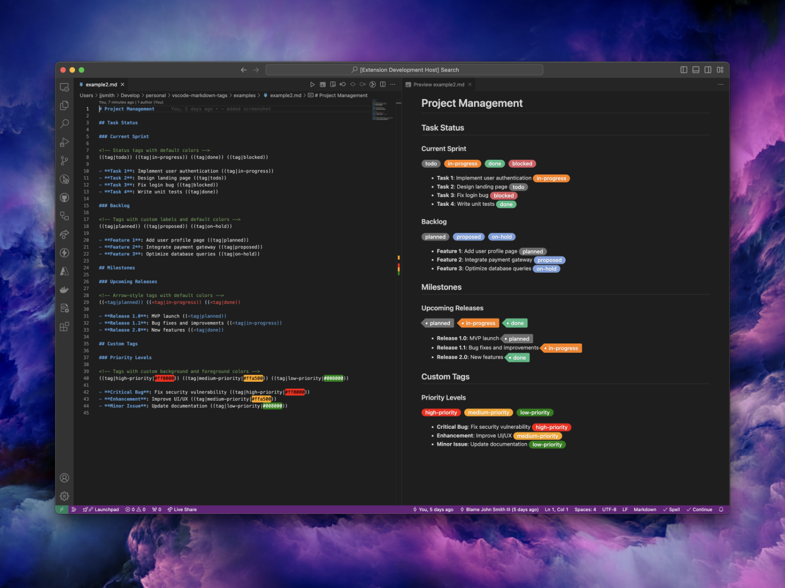

# Tags for Markdown: Enhanced Styled Labels for VS Code

[](https://marketplace.visualstudio.com/items?itemName=BinaryNoir.vscode-markdown-tags)
[](https://github.com/binarynoir/vscode-markdown-tags/actions/workflows/ci.yml)
[](LICENSE)

Add visual flair to your Markdown documents with custom tag styles! **Tags for Markdown** lets you highlight and style labels within Markdown documents using simple syntax, customizable colors, and optional arrow indicators—all in the native Visual Studio Code preview.

Also available for [VitePress](https://github.com/binarynoir/vitepress-markdown-tags) and [Obsidian](https://github.com/binarynoir/obsidian-markdown-tags).

[Documentation and live demo](https://binarynoir.tech/plugins/markdown-tags/vscode)

[](https://buymeacoffee.com/binarynoir)
[](https://ko-fi.com/binarynoir)
[](https://binarynoir.tech)



## Features

### 🎨 Styled Tags

### 🖌️ Customizable Colors

Use predefined colors or specify custom hex codes for both background and foreground colors, enabling unlimited styling options.

### 📄 Flexible Syntax

Simple, flexible syntax options (use either `|` or `/` as the separator):

```markdown
((tag|label))
((tag/label))
((tag|label|background-color))
((tag/label/background-color))
((tag|label|background-color|foreground-color))
((tag/label/background-color/foreground-color))
((<tag|label)) <!-- Adds an arrow to the left -->
((<tag/label)) <!-- Adds an arrow to the left -->
```

### 🌈 Supports a Variety of Colors

Choose from predefined colors (`grey`, `green`, `orange`, etc.) or use custom hex codes to suit your design preferences. Background colors accept a predefined name or a hex code; foreground colors accept hex codes only. Tag labels that contain Markdown emphasis characters such as `*` are split by the parser and will not render as a tag.

---

## Getting Started

1. **Install the Extension**:

   - **From Visual Studio Code**:

     1. Open Visual Studio Code.
     2. Go to the Extensions view by clicking on the Extensions icon in the Activity Bar on the side of the window or by pressing `Ctrl+Shift+X` (Windows/Linux) or `Cmd+Shift+X` (macOS).
     3. Search for `Markdown Tags`.
     4. Click on the `Install` button.

   - **From the Visual Studio Code Marketplace**:
     1. Visit [Markdown Tags on Visual Studio Code Marketplace](https://marketplace.visualstudio.com/items?itemName=BinaryNoir.vscode-markdown-tags).
     2. Click on the `Install` button.
     3. Follow the prompts to complete the installation in Visual Studio Code.

2. **Add Tags** in your Markdown files using the syntax below.
3. **Open Preview** (Right-click the Markdown file → "Open Preview" or `Ctrl+Shift+V` on Windows or `Cmd+Shift+V` on macOS) to view styled tags in action.

### Basic Syntax Examples

#### Status Tags

```markdown
((tag|todo)) ((tag/in-progress/#ffcc00)) ((tag|done|#28a745|#ffffff))
```

#### Arrowed Tags

```markdown
((<tag|planned)) ((<tag/custom test))
```

#### Customizing Colors

```markdown
((tag|background|#ff4500)) ((tag/foreground//#ff6347)) ((tag|both colors|#32cd32|#ffffff))
```

---

## Tags and Colors

Available supported tags: **todo**, **planned**, **in-progress**, **doing**, **done**, **tip**,
**on-hold**, **tbd**, **proposed**, **draft**, **wip**, **mvp**,
**blocked**, **canceled**, **error**, **warning**, **warn**

For each tag, the following colors are available: **grey**, **green**, **yellow**, **orange**, **blue**, **purple**, **red**.

[See Examples Markdown Documents](/examples/)

### Tag Examples

#### TODO

- `((tag|todo|grey))` or `((tag/todo/grey))`
- `((tag|todo|green))` or `((tag/todo/green))`
- `((tag|todo|yellow))` or `((tag/todo/yellow))`
- `((tag|todo|orange))` or `((tag/todo/orange))`
- `((tag|todo|blue))` or `((tag/todo/blue))`
- `((tag|todo|purple))` or `((tag/todo/purple))`
- `((tag|todo|red))` or `((tag/todo/red))`

#### PLANNED

- `((tag|planned|grey))` or `((tag/planned/grey))`
- `((tag|planned|green))` or `((tag/planned/green))`
- `((tag|planned|yellow))` or `((tag/planned/yellow))`
- `((tag|planned|orange))` or `((tag/planned/orange))`
- `((tag|planned|blue))` or `((tag/planned/blue))`
- `((tag|planned|purple))` or `((tag/planned/purple))`
- `((tag|planned|red))` or `((tag/planned/red))`

#### IN-PROGRESS

- `((tag|in-progress|grey))` or `((tag/in-progress/grey))`
- `((tag|in-progress|green))` or `((tag/in-progress/green))`
- `((tag|in-progress|yellow))` or `((tag/in-progress/yellow))`
- `((tag|in-progress|orange))` or `((tag/in-progress/orange))`
- `((tag|in-progress|blue))` or `((tag/in-progress/blue))`
- `((tag|in-progress|purple))` or `((tag/in-progress/purple))`
- `((tag|in-progress|red))` or `((tag/in-progress/red))`

#### DOING

- `((tag|doing|grey))` or `((tag/doing/grey))`
- `((tag|doing|green))` or `((tag/doing/green))`
- `((tag|doing|yellow))` or `((tag/doing/yellow))`
- `((tag|doing|orange))` or `((tag/doing/orange))`
- `((tag|doing|blue))` or `((tag/doing/blue))`
- `((tag|doing|purple))` or `((tag/doing/purple))`
- `((tag|doing|red))` or `((tag/doing/red))`

#### DONE

- `((tag|done|grey))` or `((tag/done/grey))`
- `((tag|done|green))` or `((tag/done/green))`
- `((tag|done|yellow))` or `((tag/done/yellow))`
- `((tag|done|orange))` or `((tag/done/orange))`
- `((tag|done|blue))` or `((tag/done/blue))`
- `((tag|done|purple))` or `((tag/done/purple))`
- `((tag|done|red))` or `((tag/done/red))`

#### TIP

- `((tag|tip|grey))` or `((tag/tip/grey))`
- `((tag|tip|green))` or `((tag/tip/green))`
- `((tag|tip|yellow))` or `((tag/tip/yellow))`
- `((tag|tip|orange))` or `((tag/tip/orange))`
- `((tag|tip|blue))` or `((tag/tip/blue))`
- `((tag|tip|purple))` or `((tag/tip/purple))`
- `((tag|tip|red))` or `((tag/tip/red))`

... _(repeat as necessary for remaining tags: on-hold, tbd, proposed, draft, mvp, etc.)_

---

### With Arrow (using `((<tag|label|bgcolor))`)

#### MVP

- `((<tag|mvp|grey))` or `((<tag/mvp/grey))`
- `((<tag|mvp|green))` or `((<tag/mvp/green))`
- `((<tag|mvp|yellow))` or `((<tag/mvp/yellow))`
- `((<tag|mvp|orange))` or `((<tag/mvp/orange))`
- `((<tag|mvp|blue))` or `((<tag/mvp/blue))`
- `((<tag|mvp|purple))` or `((<tag/mvp/purple))`
- `((<tag|mvp|red))` or `((<tag/mvp/red))`

... _(repeat as necessary for remaining tags: on-hold, tbd, proposed, draft, mvp, etc.)_

---

## Advanced Options

### CSS Integration

Add custom styles by modifying the `style.css` file in the extension folder to match your preferences.

### Error Handling

The extension defaults to `grey` when invalid colors are detected to ensure a consistent and polished look.

---

## Related projects

The same `((tag|label|color))` syntax is available in other tools. The
[VS Code extension](https://github.com/binarynoir/vscode-markdown-tags) is the
main project: start there for the syntax reference and to report issues
common to all of them.

| Project                                                                          | Where it works     |
| -------------------------------------------------------------------------------- | ------------------ |
| [vscode-markdown-tags](https://github.com/binarynoir/vscode-markdown-tags)       | Visual Studio Code |
| [obsidian-markdown-tags](https://github.com/binarynoir/obsidian-markdown-tags)   | Obsidian           |
| [vitepress-markdown-tags](https://github.com/binarynoir/vitepress-markdown-tags) | VitePress 2 sites  |

---

## License

MIT License

---

## Feedback and support

Bug reports, feature requests and questions are all welcome. Please open them on this project's [GitHub issue tracker](https://github.com/binarynoir/vscode-markdown-tags/issues):

- **Found a bug?** [Report it](https://github.com/binarynoir/vscode-markdown-tags/issues/new?labels=bug&title=Bug%3A%20). Include your version and the steps to reproduce it.
- **Have an idea?** [Request a feature](https://github.com/binarynoir/vscode-markdown-tags/issues/new?labels=enhancement&title=Feature%20request%3A%20). Tell us what you are trying to do.
- **Something else?** [Browse open issues](https://github.com/binarynoir/vscode-markdown-tags/issues) to see if it has already been raised.

Pull requests are welcome too.

## More from BinaryNoir

<p align="center">
  <a href="https://binarynoir.tech">
    <picture>
      <source media="(prefers-color-scheme: dark)" srcset="https://binarynoir.tech/logo-wide-dark.png">
      
    </picture>
  </a>
</p>

Tags for Markdown for VS Code is one of a family of open-source VitePress plugins, editor extensions and command-line tools from BinaryNoir. Browse them all, with documentation and live demos, at **[binarynoir.tech](https://binarynoir.tech)**.

**VitePress plugins**

- [Auto Sidebar](https://binarynoir.tech/plugins/auto-sidebar): sidebar built from your folders
- [Auto Navbar](https://binarynoir.tech/plugins/auto-navbar): navbar built from your folders
- [Markdown Tags](https://binarynoir.tech/plugins/markdown-tags/): inline status badges
- [Reading Time Tag](https://binarynoir.tech/plugins/reading-time-tag): reading-time estimates
- [Glossary Tooltips](https://binarynoir.tech/plugins/glossary/): hover definitions from one glossary file
- [Downloads](https://binarynoir.tech/plugins/downloads): downloadable files next to your pages
- [Exclude](https://binarynoir.tech/plugins/exclude/): keep pages out of the build with a `.exclude` file
- [README Index](https://binarynoir.tech/plugins/readme-index/): `README.md` index pages for VuePress migrations
- [HTML Escape](https://binarynoir.tech/plugins/html-escape/): stray tags and braces shown as text, not build errors
- [Broken Links](https://binarynoir.tech/plugins/broken-links): dead links shown as text, not build errors

**Vite plugins**

- [Optimize Images](https://binarynoir.tech/plugins/optimize-images): smaller images in the build output
- [Image Fallback](https://binarynoir.tech/plugins/image-fallback): a placeholder instead of a failed build

**Editor extensions**

- [Tags for Markdown for Obsidian](https://binarynoir.tech/plugins/markdown-tags/obsidian): status badges in Obsidian

**Command-line tools**

- [NoirWatch](https://binarynoir.tech/apps/noirwatch): get notified when a web page changes
- [NoirCon](https://binarynoir.tech/apps/noircon): get notified when a site, server or port goes down
- [callrx](https://binarynoir.tech/apps/callrx): amateur radio callsign lookup

Website, docs and demos: **[binarynoir.tech](https://binarynoir.tech)**

## Author

John Smith III, [BinaryNoir](https://binarynoir.tech). Thanks to all contributors and users for their support and feedback.
